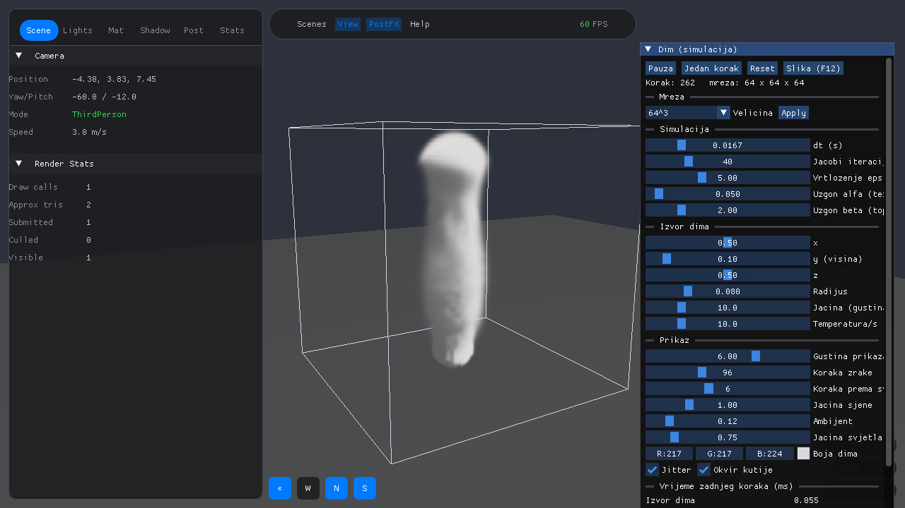

# Integration: dim u rendereru (M-VIZ)

Ovaj folder je **jedino mjesto koje poznaje i `Solver/` i `Renderer/`** (ARCHITECTURE.md, odjeljci 1, 6 i 8).
Solver i dalje nema OpenGL, a Renderer i dalje ne zna da dim postoji.



## Kako se gradi i pokreće

Gradi se zajedno s Rendererovom test aplikacijom (nije samostalan projekat):

```
cmake -S Renderer -B Renderer/build -G "MinGW Makefiles" -DFETCHCONTENT_FULLY_DISCONNECTED=ON
cmake --build Renderer/build --parallel
cd Renderer
build\test-app\TestApp.exe
```

- Program se pokreće **iz foldera `Renderer/`**, jer Renderer svoje shadere i `config/settings.json` traži
  relativno od radnog foldera.
- `-DFETCHCONTENT_FULLY_DISCONNECTED=ON` kaže CMake-u da koristi već preuzete biblioteke. Bez toga Rendererov
  CMake pri svakom konfigurisanju pokušava osvježiti `stb` (prati granu `master`) i na PC-2 pada na git
  konfliktu. Pri **prvoj** gradnji na novom računaru opcija se izostavlja, da se biblioteke preuzmu.
- Scena dima se otvara prva. Ostale scene Renderera su i dalje na tipkama 1, 2, 3...

Upravljanje: desna tipka miša i pomjeranje rotira kameru oko kutije, točkić približava, WASD pomjera centar,
F12 snima sliku (`smoke_screenshot_N.png` u radnom folderu).

## Dijelovi

| Fajl | Šta je | Odakle dolazi | Ko ga koristi |
| :--- | :--- | :--- | :--- |
| `SmokeScene` | Scena: drži jedan `SmokeSolver`, pod, svjetlo i kameru | Rendererova klasa `Scene` (tri "kuke": `OnUpdate`, `OnPostRender`, `OnImGuiRender`); ARCHITECTURE.md, odjeljak 8 | `Renderer/test-app/src/main.cpp` je registruje |
| `Texture3D` | 3D tekstura s jednim float kanalom; u njoj je gustina dima na grafičkoj kartici | Renderer ima samo 2D teksture, pa je pišemo sami | `SmokeScene` je puni svaki frejm, shader iz nje čita |
| `VolumeRaymarchPass` | Crta dim: zraka kroz kutiju, uzorkovanje, prozirnost | [Crane07] (GPU Gems 3, pogl. 30), Beer-Lambertov zakon | `SmokeScene::OnPostRender` |
| `BoxOutline` | 12 ivica kutije kao linije | pomoć pri razvoju: kutija je inače nevidljiva | `SmokeScene::OnPostRender` |
| `SmokeUI` | ImGui panel: mreža, parametri, izvor, prikaz, vremena | parametri su `smoke::SmokeParams`, vremena `smoke::StepTimings` | `SmokeScene::OnImGuiRender` |
| `Screenshot` | Snima prozor u PNG | `stb_image_write` (dio paketa `stb` koji Renderer već preuzima) | F12, dugme u panelu, automatska provjera |
| `shaders/` | GLSL izvor za dim i okvir | | učitava ih Rendererov `ShaderProgram` |

## Šta se dešava u jednom frejmu

1. **`OnUpdate`**: jedan korak simulacije, `solver.step()`, s korakom `dt` iz parametara (ne s vremenom frejma).
   Jedan korak po frejmu u glavnoj niti je odluka D17; fiksan `dt` čuva determinizam (isti ulaz daje isti izlaz).
2. Renderer crta neprozirne objekte (pod) u HDR bafer.
3. **`OnPostRender`** (poslije neprozirnih objekata, prije tone mappinga):
   - `Texture3D::Upload` kopira gustinu u teksturu,
   - `BoxOutline` crta ivice,
   - `VolumeRaymarchPass` crta dim preko svega.
4. Renderer radi bloom i tone mapping, pa **`OnImGuiRender`** crta panel i izvršava ono što je korisnik tražio
   (Apply, Reset, Jedan korak).

## Prenos gustine: bez kopiranja

Solver čuva polje s ghost slojem i paddingom reda, pa unutrašnje ćelije nisu jedna do druge u memoriji.
`smoke::DensityView` to opisuje: pokazivač na prvu unutrašnju ćeliju, `strideJ` (koliko floatova do sljedećeg
reda) i `strideK` (do sljedeće ravni).

OpenGL zna čitati baš takvu memoriju ako mu se kaže stvarna dužina reda i stvarni broj redova po ravni:
`GL_UNPACK_ROW_LENGTH = strideJ` i `GL_UNPACK_IMAGE_HEIGHT = strideK / strideJ`. Zato `glTexSubImage3D` čita
direktno iz solverovog niza, **bez međukopije**. Poslije poziva te dvije postavke vraćamo na 0, jer su globalne
i Rendererova učitavanja tekstura računaju na zadane vrijednosti. Ako raspored jednom ne bude imao cijeli broj
redova po ravni, `Texture3D` sam prelazi na kopiranje u zbijen bafer.

Format teksture je `GL_R32F`: isti tip kao u solveru, pa drajver ništa ne pretvara. Na 128³ to je 8 MiB.
Izmjereno vrijeme prenosa ispisuje panel ("Prenos gustine na GPU").

## Kako se crta dim (ray marching)

Za svaki piksel:

1. **Zraka.** Kreće iz kamere kroz taj piksel. Smjer se dobije iz inverzne matrice pogleda i projekcije.
2. **Presjek s kutijom.** Metoda "ploča" (slab): zraka je u kutiji tamo gdje je istovremeno između dvije
   ravni po svakoj osi. Dobijemo ulaz `t0` i izlaz `t1`; ako zraka promaši kutiju, piksel se preskače.
3. **Koraci.** Dio zrake u kutiji dijelimo na N jednakih koraka dužine `ds`. U svakom čitamo gustinu `ρ` iz
   3D teksture (linearno filtriranje daje trilinearnu interpolaciju, istu ideju kao u advekciji solvera).
4. **Beer-Lambert.** Sloj debljine `ds` propušta `exp(−σ·ρ·ds)` svjetla, pa mu je neprozirnost
   `a = 1 − exp(−σ·ρ·ds)`. Vodimo `T`, koliko svjetla još prolazi do kamere:
   `boja += T·a·(boja dima · svjetlo)`, pa `T *= 1 − a`. Kad `T` padne ispod 0.01, prekidamo.
5. **Sjena u dimu.** Iz svakog uzorka pravimo nekoliko koraka prema svjetlu i sabiramo gustinu na tom putu;
   više dima između uzorka i svjetla znači tamniji uzorak. Zato dim ima svijetlu i tamnu stranu.
6. **Miješanje.** Shader vraća boju već pomnoženu neprozirnošću i `1 − T`; OpenGL računa
   `rezultat = dim + pozadina·(1 − neprozirnost)`.

`σ` je klizač "Gustina prikaza". To je postavka prikaza, ne fizike: ne mijenja simulaciju. Isto vrijedi za
broj koraka, sjenu, boju i jitter (jitter pomjera prvi uzorak po pikselu, da se umjesto "prstenova" vidi sitan šum).

## Ograničenja ove verzije

- **Objekti ne zaklanjaju dim.** Rendererov depth bafer se ne može čitati u shaderu, pa se dim crta preko svega.
  Rješava se u M-OBS (odluka D13: depth u teksturu).
- **Kutija je poravnata s osama**, bez rotacije. "Gore" je +Y i u Rendereru i u solveru (uzgon).
- **128³ nije interaktivan** (oko 11 FPS na PC-2, RTX 4060 Ti; ograničava korak simulacije, ne crtanje). Za demo 64³.
- **Shaderi se čitaju iz izvornog foldera** (`Integration/shaders`, apsolutna putanja upisana pri gradnji), pa
  izmjena shadera ne traži ponovnu gradnju, ali se program ne može prenijeti bez tog foldera.
- **Shaderi nemaju liniju `#version`.** Dodaje je Rendererov `ShaderProgram` (GLSL 3.30 do 4.10, prema kontekstu).

## Provjera bez ruku

```
cd Renderer
set SMOKE_AUTOSHOT_STEPS=260
set SMOKE_AUTOSHOT_FILE=C:\putanja\slika.png
set SMOKE_AUTOSHOT_GRID=128        (opcionalno; zadano 64)
build\test-app\TestApp.exe
```

Program uradi zadani broj koraka, snimi sliku prozora i zatvori se. Tako su napravljene slike u `docs/plan/img/`.
